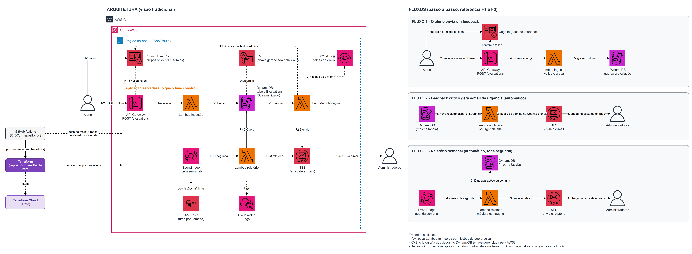

# feedback-lambda-ingestion

**Ingestion** Lambda for the Class Feedback Platform — Tech Challenge phase 4, serverless architecture on AWS.

Students submit `POST /evaluations` with `{"description": string, "score": int 0..10}`.
Administrators receive an urgent-feedback email (low scores) and a weekly report.

## The 4 repositories

| Repository | Responsibility |
|---|---|
| [feedback-infra](../feedback-infra) | Terraform for all infrastructure |
| **feedback-lambda-ingestion** (this one) | Receives the evaluation and writes it to DynamoDB |
| [feedback-lambda-notification](../feedback-lambda-notification) | Notifies admins by email when urgency is high |
| [feedback-lambda-report](../feedback-lambda-report) | Generates and sends the weekly report |

## Architecture



Diagram source: [`docs/architecture.drawio`](../feedback-infra/docs/architecture.drawio) in feedback-infra.

## What it does

API Gateway (HTTP API, payload v2) calls this function after the Cognito JWT authorizer validates the token. The function validates the body, computes the urgency and writes the evaluation to the `Evaluations` table.

- **Function:** `feedback-ingestion` · Java 21 · 512 MB · `sa-east-1`
- **Permission:** only `dynamodb:PutItem` on `Evaluations`
- **Environment variable:** `TABLE_NAME`

### Request

```http
POST /evaluations
Authorization: Bearer <Cognito JWT>

{ "description": "non-empty text, up to 1000 characters", "score": 7 }
```

`userId` is the token's `sub` claim — it is never read from the body.

### Responses

| Status | Body |
|---|---|
| `201` | `{"evaluationId": "<uuid>"}` |
| `400` | `{"message": "<validation error>"}` |
| `401` | `{"message": "Unauthorized"}` (no `sub` in the token) |
| `500` | `{"message": "Could not save the evaluation"}` |

### Urgency rule

| Score | Urgency |
|---|---|
| 0 to 3 | `high` |
| 4 to 6 | `medium` |
| 7 to 10 | `low` |

## Code structure

Hexagonal architecture (ports and adapters), enforced by ArchUnit tests.

```
com.feedback.ingestion
├── IngestionHandler          # Lambda entry point
├── domain/                   # Evaluation, Score, Description, Urgency (no AWS dependency)
├── application/              # SubmitEvaluationUseCase and output ports
├── adapter/in/apigateway/    # HTTP event → command, result → HTTP response
├── adapter/out/dynamodb/     # EvaluationRepository on DynamoDB
└── config/                   # Environment variables and dependency wiring
```

## Build and test

```bash
./mvnw verify
```

Unit tests use mocks only (no AWS calls). The build fails below **80% coverage** (JaCoCo) and produces the shaded jar in `target/`.

## Pipeline

`.github/workflows/ci-cd.yml`:

- **Pull request:** build and test.
- **Push to `main`:** build, test and publish the jar with `aws lambda update-function-code`, authenticated through GitHub OIDC (no static AWS keys). The role, `feedback-github-lambda-ingestion`, can only update this function's code.

Required GitHub variable: `AWS_ROLE_ARN` (output `function_pipeline_role_arns` of `feedback-infra`).

**LGPD:** logs contain only ids and error types, never the description or user data.
